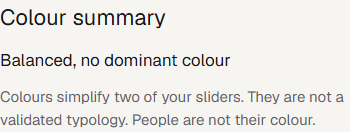
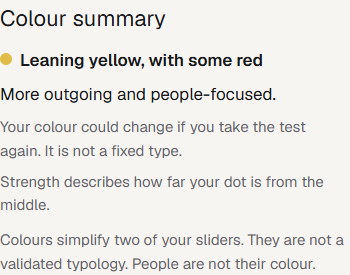
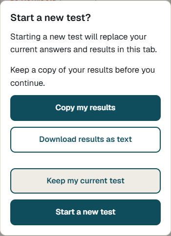

# Show colour leans and protect results

Wide retake bands previously made an outgoing, cooperative result say "Balanced, no dominant colour". The colour block now follows the existing dot position and describes its strength. The example with E = 0.25, A = 0.70 and C = 0.30 now says "Leaning yellow, with some red", with a short explanation of uncertainty.

Distance is `Math.hypot(E, (A - C) / 2)` on the existing slider scale. Named thresholds are:

- Balanced: distance below 0.05.
- Light: distance from 0.05 to below 0.20.
- Leaning: distance from 0.20 through 0.50.
- Strong: distance above 0.50.
- Secondary colour: an axis has magnitude below 0.15 or its band crosses zero. Choose the closest qualifying axis and flip that axis. Focus wins exact ties. Show at most one secondary colour.
- Dot opacity: 0.4 for Light, 0.7 for Leaning and 1 for Strong.

Light results explain that they sit close to the middle. Stronger results with both bands crossing zero use separate retake wording. A short description explains the colour, and strength is explicitly described as distance rather than certainty. Missing E, A or C produces "Colour summary unavailable", as agreed, rather than implying a measured Balanced result.

The homepage resumes progress or opens completed results. Restarting requires confirmation, with an opportunity to keep a copy. The results page offers copy and text download near the top. Clipboard failures reveal focused, selectable text. Screen and export share the colour wording and caveats.

Feature flags, scoring, bands, saved-session format, Go deeper logic, API routes and Convex are unchanged. Existing saved sessions are rendered without adding stored colour fields. Export happens entirely in the browser.

## Mobile evidence

Both captures use the same synthetic example at a 390px viewport. Images show the 350px-wide colour block inside the page's existing padding.

Before:

After:

Restart confirmation:

## Validation

- Unit tests cover strengths and exact thresholds, four quadrants, secondary selection and ties, missing traits, wide bands, the regression example, text and dot opacity.
- Browser tests cover mobile screenshots, legacy session rendering, progress resume, cancel and confirm restart, clipboard success and failure, matching text downloads, and accessibility of the dialog.
- Existing browser checks cover core and deeper flows, privacy, refresh, layout and automated accessibility checks.

- `npm test`: 149 tests passed across 42 files.
- `npm run lint`: passed.
- `npm run typecheck`: passed, including the existing Convex type check.
- `PLAYWRIGHT_CHANNEL=chrome pnpm exec playwright test`: 62 checks passed across desktop and mobile projects. Screenshots were visually inspected.
- `npm run build`: passed with the existing prototype's required `ALLOW_UNCALIBRATED=true` and `ALLOW_DRAFT_CONTENT=true` settings supplied to this command only.
- `git diff --check`: passed.

The development server logs Next.js `instant` validation diagnostics on the existing `/consent` and `/feedback` redirect routes. Both redirect checks pass and the production build passes. Those routes were not changed.

The mobile captures and validation notes are included with the change for review.
